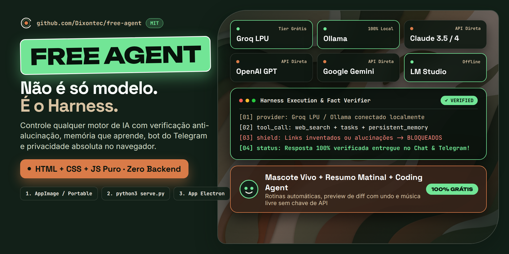

# Free Agent — Local-First AI Harness

<p align="center">
  
</p>


> **Keywords:** local-first · AI harness · browser-based · no backend · no lock-in · LLM orchestrator · multi-provider · Groq · OpenAI · Gemini · Anthropic · Ollama · LM Studio · OpenRouter · coding agent · scheduled routines · skills · tasks · reminders · notes · voice dictation · Telegram bot · mascot · privacy · open source · MIT · free & open-weight models

> Free Agent is a 100% browser-based, local-first harness that sits between you and AI providers. No backend, no telemetry, no lock-in — your API keys never leave your machine.

**[🇺🇸 Read in English](#-english) · [🇧🇷 Leia em Português](#-português)**

   

---

<a name="english"></a>
## 🇺🇸 English

### What is Free Agent

**Free Agent** is a web panel that sits between you and AI providers (Groq, OpenAI, Gemini, Anthropic, Ollama, LM Studio, OpenRouter). It is not a model — it is the **harness**: the reliable layer that decides when to call the model, when to fetch real data from the web, when to ask for human confirmation, when to run a scheduled routine, and when to say "could not verify, marked as pending" instead of inventing an answer.

Around that core sits a complete daily cockpit: a chat that remembers (conversations, notes, Agent Memory), AI tasks, reminders, scheduled routines, free music with your own local library, a coding agent that edits real project files with diff preview, a Telegram bot that connects straight from the browser, a live **Monitor Agent** terminal, voice dictation that runs offline, an agent team you create yourself, and a built-in update checker fed by GitHub Releases — everything local, everything yours.

Principles:

1. **Local-first & private** — runs as static files + `localStorage`. Your API keys never leave your browser except for direct calls to the official provider APIs you configure. No accounts, no telemetry, no proprietary backend.
2. **Reliability over speed** — ReAct loop with max 8 steps, 25s LLM timeout, deterministic verification before delivery. Without `VERIFIED`, the answer ships marked as pending.
3. **No hallucinated links** — every cited URL must come from a tool. Invented URLs are rejected automatically.
4. **Sandbox + human approval** — opening sites asks for confirmation, destructive commands are blocked, export never includes keys.
5. **Rules that were earned** — every line of the agent's system prompt points to the real failure that created it (like "said it opened a site without opening it → gate + VERIFIED"). The harness was forged in production, not on a whiteboard.

### Features

#### Chat, conversations & memory

- **Daily greeting by the LLM** — on load, the agent reads your tasks, reminders, notes and Agent Memory and writes a short, gentle context summary of your day (cached per day, regenerated automatically when your data changes).
- **Harness chat with commands**: `/news <topic>` · `/wiki <term>` · `/yt <link or query>` · `/rotina 08:00` · `/musica <name>` · `/skill <name>` · `/teste-voz` · `/undo` — plus natural language ("search for…", "remind me at…").
- **Multiple conversations** — create, rename and delete chats; a grid shows summary, date and last message; titles are generated automatically; and **search finds the right old chat "by what we remember"** from a few words.
- **@skills with autocomplete** — type `@` in the composer and invoke any skill with arrows/Tab; plus **custom chat chips**: your own buttons that send a saved prompt in one click.
- **Attach context** — drop a folder (up to 8 text files), a text file inline, or audio/video into the **MediaDock** sitting inside the conversation; the agent reads what you attach.
- **Selection popup in the chat** — select any text and a small bubble offers **Copy** or **Create note** (with a name field), turning a highlight into a saved note in one click.
- **Context bar + quick model picker** right in the composer — real token usage per conversation and the model switch without opening Settings.

#### Providers (7, two of them 100% local)

- **Groq** (free tier, recommended) · **OpenAI** · **Gemini** · **Anthropic** · **Ollama** (local) · **LM Studio** (local) · **OpenRouter/compatible**. Native path per provider (Gemini `system_instruction`, Anthropic browser headers, Ollama options, custom `baseUrl` for vLLM/llama.cpp), model refresh from the API, custom saved models, connection test, keys masked in Settings.

#### Routines, tasks, reminders & notes

- **Scheduled routines** — e.g. daily 08:00 → play music + video + news + open apps + AI prompt. Actions (`musica:` `youtube:` `noticias:` `prompt:` `abrir:` `skill:`) are each verified after running; built-in scheduler + notifications + voice.
- **AI tasks** — create, edit inline, complete, list; the agent touches them only through verified tools.
- **Reminders** (once or daily) with browser notification + spoken voice, and they wake the screen saver.
- **Notes** — full CRUD, full-screen viewer with one-click copy, readable by the agent (`list_notes`).
- **Works without any AI key** — a local intents engine handles tasks, notes, reminders, routines, music and opening sites by itself.

#### Skills

- **10 built-in skills**: deep web research, news digest, morning routine, YouTube player, music & focus, app opener, smart summarizer, Linux automation, multi-provider search, web browser — plus **full CRUD to create your own** (slug, icon, prompt, auto-action, on/off) and an optional version-locked `web-search` skill.

#### Music — free, legal and yours

- **Search Creative Commons instantly, no key**: Internet Archive + Wikimedia in parallel, play or download MP3. Persistent queue, authorized folder, chat commands.
- **Your own local library** — upload files or a whole folder into an IndexedDB library; the agent searches there first and plays from disk.
- **YouTube by phrase, no URL** — say "play <song>" and it searches; when the embed is blocked, an **alternatives queue** keeps the music going.

#### Coding agent (plan/build)

- Read, search, edit and create real project files with **LCS diff preview**, per-tool permissions (allow/ask/deny), up to 50 in-memory **snapshots/undo** (no git required), **syntax diagnostics** after writes (JS/JSON) and a workspace jailed to the authorized folder — paths with `..` or absolute paths never escape.
- **Materialize code from the chat** — code blocks in a reply can be saved to the workspace as a real file with preview.
- **Optional local shell** via `bridge.py`: pure Python stdlib, binds only to `127.0.0.1`, random token per run, directory jail, blocklist (`rm -rf /`, `mkfs`, `shutdown`, `crontab -r`…), timeouts. `serve.py` runs the app + `/exec` + `/tg-*` on the same port.

#### Telegram bot, zero setup

- Connects **straight from your browser** to the Telegram API: paste the token from `@BotFather` → **Connect**. No Python, no terminal, no bridge. The token lives only in your `localStorage`, long-polling begins by itself whenever the app opens with a saved token, and it recovers automatically after sleep/offline. The bot answers through the same agent loop — skills, tasks, notes and Agent Memory included. Full walkthrough below.

#### Monitor Agent, terminal & media

- **Live terminal in the Monitor Agent** — the top-right monitor (titled **Monitor Agent**) shows the whole app log in real time (color-coded, timestamps, auto-scroll you can pause/resume with a discreet ⏸/▶, click to expand), right from the first load; when opened it rolls fast straight to the latest line.
- **Sandboxed previews** — HTML renders in a sandboxed iframe, YouTube plays with volume/mute/expand, media cards live in the chat, and a video can pop out into its own window.
- **Rest screen (screensaver)** — pick the minutes; the screen dims to a clock, wakes with Space/Enter/click and **reads your day back to you in voice**.

#### Voice — dictation that stays on your machine

- **Offline dictation with local Whisper** — Ctrl+Space, speak, and transcription runs in your browser (one-time model download, automatic fallback to tiny; browser dictation as visible fallback). A live waveform pill and progress bar while you talk.
- **`/teste-voz` certification** — records 6 seconds, transcribes and sends to the AI: an end-to-end proof that the voice path works.
- **Spoken output** (pt-BR TTS) for reminders, routines and the rest screen.

#### Agent team — secretary, briefing and your own agents

- **Secretary** runs every night: summarizes the whole app memory (tasks, reminders, notes, corrections), appends it to the memory note and saves a `free-agent-resumo-YYYY-MM-DD.md` file. **Briefing** posts a morning summary in the chat at your chosen time.
- **Create your own subagents** in the Agents tab — name, icon and personality; `@name` routes a message to one of them; and **teamFlow** splits a complex task into up to 6 fronts and synthesizes the result.

#### Mascote Agent — a companion you own

See the dedicated section below: an animated companion with a birth certificate (date, time and **moon phase** of its awakening), the full **lineage of every model you connected** and a **Life Tokens** bar counting every token ever spent through the app — even if you change AI model, your mascot stays with you.

#### Interface, ambient & system

- **Premium themes & backgrounds** — Light · Dark · Glass, plus a background gallery with high-resolution organic paper-cut artwork (green and pink) as the first-run default, on top of a **Three.js 3D scene** (icosahedron, rings, 900 particles, mouse parallax; auto-disables on weak GPUs or low battery).
- **Neural network canvas** — your skills (blue) and memories (pink) light up with live pulses as the agent uses them.
- **Clock + weather** via Open-Meteo with no key — and it **never writes your city into the DOM** (only coarse coordinates, cached).
- **System monitor** — real CPU, RAM, GPU, cores and battery in the sidebar.
- **Multi-language UI** — full interface in **Portuguese (BR)**, **English** and **Spanish**, with dynamic greetings and agent prompts in the chosen language.
- **Browser notifications** — asked once, only if you haven't decided yet.
- **Keyboard shortcuts** — Ctrl+Space (voice), Space/Enter (wake from rest screen), Esc (close anything).

#### Updates, data & quality

- **Update checker, built-in** — the bell in the top bar asks GitHub Releases for the latest Free Agent version, shows a short “what changed” note and one-click download links for **Linux (AppImage)** and **Windows (portable)**. Nothing installs itself; your keys and data stay untouched.
- **Export / import everything as JSON** with `stripSecrets()` — keys become `***`, `baseUrl` is removed; nothing sensitive ever leaves the browser.
- **Automated eval**: `node eval/run-eval.mjs` (logic + three real-loop scenarios — one agent that lies, one honest, one stubborn — exit 0/1 for CI) + in-browser self-test `?eval=1` against the live app, fully isolated from your data.

### The Mascote Agent — your companion has a birth certificate

Free Agent is not a cold console — it's a companion you own. The **Mascote Agent** gives your local AI a face and a life story:

1. **It sleeps until it's real** — with no provider connected the mascot is gray and dozing: nothing runs, nothing is invented. Connect a free provider and it wakes up, eyes following your cursor, mood shifting between idle, thinking and processing.
2. **It has a birthday** — the **AI Life Card** is a draggable certificate recording the exact date, time and **moon phase** of its awakening, plus the first model that brought it to life.
3. **It grows with you — Life Tokens** — every token you spend through the app (Groq, OpenAI, Gemini, Anthropic, local Ollama… all summed, all providers) feeds a lifetime counter and progress bar: your mascot's **Life Tokens**. Change from Groq to Gemini to a local model and the card keeps the full **lineage** — every model that ever talked through your agent is part of its story. The state lives in your browser's `localStorage`: it survives app updates, backups and reinstalls.
4. **It's yours** — give it a name and it owns the top bar (you can toggle that off). Edit the name and you consciously start a new life cycle — the old one ends, a new birth is recorded. **Even if you change AI model, even if you change computer and restore your export, your mascot continues with you. He is yours.**

### Free providers & getting your API keys

You don't need to pay to use Free Agent:

- **Groq (free, recommended)** — free tier with very fast open models: [console.groq.com](https://console.groq.com) → **API Keys** → **Create** → copy → paste in **Settings → Connection**.
- **OpenAI** — [platform.openai.com](https://platform.openai.com) → API keys.
- **Gemini** — [aistudio.google.com](https://aistudio.google.com) → **Get API key**.
- **Anthropic** — [console.anthropic.com](https://console.anthropic.com) → API keys.
- **100% local, no key** — [Ollama](https://ollama.com) (`ollama serve`) or LM Studio (Server → Start) on `localhost`.

Inside the app: **Settings → Connection → “Where to get keys”** opens the same step-by-step guide.

> **We never receive your API keys.** Free Agent has no backend and no server of ours — keys are saved only in your browser's `localStorage`, and are sent only from your machine directly to the official endpoint of the provider you chose (e.g. `api.groq.com`). They never pass through us, proxies, logs, traces or backups.


### Install (2 minutes)

Prerequisite: any modern browser + Python 3 (only to serve local files).

```bash
git clone https://github.com/Dixontec/free-agent.git
cd free-agent
python3 serve.py           # app + Telegram/Coding endpoints, same port
# open http://localhost:8080
```

> Use a local server (not `file://`) so Three.js modules load from CDN.
> `serve.py` is the integrated one (same port 8080) — it also exposes `/health`
> and `/tg-*`, so **Settings → Telegram → Connect** works with no extra setup.

Full guide: [`docs/en/install.md`](docs/en/install.md)

### Desktop app (optional)

Free Agent also ships as a desktop app (Electron, single instance, stable origin on `127.0.0.1:47811`):

```bash
npm start        # run as desktop app
npm run dist     # build Free-Agent-<version>-x86_64.AppImage
```

Windows portable builds are published on the same Releases page, and the **bell in the app** offers one-click download of both.

### Quick start

1. Open **Settings → Connection & Model**, pick **Groq**, paste your key from [console.groq.com](https://console.groq.com) (stored only in your browser) and click **Test connection**.
2. No key? Local commands still work: `/news technology`, `/wiki AI`, `play lofi`, routines and the local player need no AI.
3. Talk to it by voice: **Ctrl+Space**, speak, **Space** again to send. Run `/teste-voz` once to certify the whole path.
4. Create a routine: **Routines → New routine → 08:00**, actions:
   ```
   musica: https://www.youtube.com/watch?v=VIDEO_ID
   noticias: technology
   prompt: Good morning! Summarize the news and plan my day with 3 priorities.
   abrir: https://gmail.com
   ```
5. To code on a project: **Settings → Coding → Authorize folder**, pick Plan or Build, and (optionally) run `python3 bridge.py --root /path/to/project` to enable local shell with a token.
6. To talk to your agent from your phone: **Connect a Telegram bot in 30 seconds** (below).
7. **Not sure where something is?** Open **Settings → Help** — 10 quick cards cover almost everything.

Guides: [`docs/en/usage.md`](docs/en/usage.md) · [`docs/en/routines.md`](docs/en/routines.md) · [`docs/en/skills.md`](docs/en/skills.md) · [`docs/en/providers.md`](docs/en/providers.md) · [`docs/en/bridge.md`](docs/en/bridge.md)

### Connect a Telegram bot in 30 seconds

**No Python, no terminal, no bridge.** The bot talks to Telegram **directly from your
browser** — the API answers with `access-control-allow-origin: *` and a `GET` long-poll
is a *simple request*, so no CORS preflight gets in the way. Everything runs in the page.

1. In Telegram open **[@BotFather](https://t.me/BotFather)** and send `/newbot`.
2. Choose a display name and a `username` that ends in `bot`. BotFather replies with a
   **token** like `123456789:AAH…` — copy the whole thing.
3. In Free Agent open **Settings → Telegram** (paper-plane icon), paste the token and
   click **Connect**. The pill turns green: *connected*.
4. Send any message to your bot. It answers through the same agent loop — skills, tasks,
   notes and Agent Memory included. Watch it live in **step 4 · Activity**.

That's the whole integration. A few useful details:

- **It stays connected by itself** — with a saved token the long-polling starts every
  time you open the app, survives screen-off and Wi-Fi drops (exponential backoff), and
  turns green again automatically once the network is back.
- **Works with any local server** — `serve.py`, `python3 -m http.server`, `npx serve`,
  `php -S`… the page itself is enough, because the connection never leaves your browser.
  (`serve.py` is only needed for the coding agent's local shell.)
- **Chat ID (optional)** — paste your own chat ID to allow only that conversation.
- **Disconnect** stops polling immediately; nothing keeps running afterwards.
- **Token privacy** — it lives only in your browser's `localStorage` and is sent straight
  to `api.telegram.org` from your machine. No server of ours in between, nothing logged.

Stuck? Token invalid → copy it again from BotFather with no extra spaces. Connected but
silent → send `/start` to the bot first, then talk to it.

### Security & privacy

- **We never receive your API keys — zero.** Free Agent has no backend and no server of ours; nothing is ever sent to us.
- Keys live in `localStorage` (`nexus:keys`) — browser-only storage. Export goes through `stripSecrets()`; keys become `***` and `baseUrl` is removed.
- Keys are sent **only** to the official API endpoint of the provider you configured (e.g. `api.groq.com`), in the `Authorization` header. Never to proxies, logs, traces or backups.
- `open_site` always asks for confirmation. Off-allowlist hosts require explicit approval.
- `bridge.py`: binds only to `127.0.0.1`, random token per run, directory jail (`--root`), blocklist (`rm -rf /`, `mkfs`, `shutdown`, `crontab -r`, ...), timeouts.
- No telemetry. No proprietary backend. Details: [`docs/en/security.md`](docs/en/security.md) · [`SECURITY.md`](SECURITY.md)

### Eval & quality

```bash
node eval/run-eval.mjs   # exit 0 = green · exit 1 = regression
```

In the browser: `http://localhost:8080/?eval=1` — end-to-end scenarios against the live app with full snapshot/restore of your data. Details: [`docs/en/eval.md`](docs/en/eval.md)

### Layout

```
free-agent/
├── index.html          # layout (topbar, sidebar, chat, panel, modals)
├── styles.css          # light / dark / glass themes
├── serve.py            # local server (app + /health + /exec + /tg-*) on :8080
├── bridge.py           # optional local bridge (shell + fetch, stdlib only)
├── package.json        # desktop app (Electron) + electron-builder targets
├── AGENTS.md           # harness system prompt (earned rules)
├── HARNESS.md          # v2 architecture, limits, future removal
├── desktop/            # Electron main + embedded static server (:47811)
├── js/
│   ├── app.js          # engine: providers, chat, routines, skills, tasks, notes, agents team
│   ├── harness-core.js # ReAct loop (orchestrator)
│   ├── tools-registry.js # 24 tools + on-demand schemas
│   ├── context-budget.js # context budget + offload
│   ├── verifiers.js    # deterministic verification
│   ├── gate.js         # sandbox + stripSecrets
│   ├── trace-store.js  # JSONL observability
│   ├── code-agent.js   # coding agent plan/build
│   ├── skills.js       # default skills catalog
│   ├── updates.js      # update checker (GitHub Releases)
│   ├── telegram.js     # browser-native Telegram bot
│   ├── voice.js        # local Whisper dictation + TTS
│   ├── music-player.js · music-repos.js · local-music.js
│   ├── sandbox.js · term-live.js · system monitors
│   ├── three-bg.js · neural.js · clockwx.js · v2-bridge.js
├── hooks/              # pre-tool.js (feedforward) · post-tool.js (feedback)
├── eval/               # golden-tasks.json · run-eval.mjs · browser-eval.js
├── .agents/skills/web-search/  # optional multi-provider search skill
└── docs/               # full guides in English and PT-BR
```

Architecture: [`docs/en/architecture.md`](docs/en/architecture.md) · [`HARNESS.md`](HARNESS.md)

### FAQ

**Offline?** AI APIs and news need internet. Local player, local music library, prompt-less routines, voice dictation (after the one-time model download) and local Ollama work offline. **Free?** The app is MIT. Groq has a free tier; Ollama/LM Studio are free and local. **Do my keys go to your server?** No — there is no server, only direct calls from your browser to official APIs. More: [`docs/en/faq.md`](docs/en/faq.md)

---

<a name="pt"></a>
## 🇧🇷 Português

### O que é o Free Agent

O **Free Agent** é um painel web que fica entre você e os provedores de IA (Groq, OpenAI, Gemini, Anthropic, Ollama, LM Studio, OpenRouter). Ele não é um modelo — é o **harness**: quem decide quando chamar o modelo, quando buscar dado real na web, quando pedir confirmação, quando agendar uma rotina e quando dizer "não consegui verificar, está pendente" em vez de inventar resposta.

Em volta desse núcleo existe um cockpit completo do dia a dia: um chat que lembra (conversas, notas, Memória do Agente), tarefas com IA, lembretes, rotinas agendadas, música grátis com a sua própria biblioteca local, coding agent que edita arquivos de projeto de verdade com preview de diff, bot do Telegram que conecta direto do navegador, terminal ao vivo do **Monitor Agent**, ditado por voz que roda offline, uma equipe de agentes que você mesmo cria e um verificador de atualizações alimentado pelas Releases do GitHub — tudo local, tudo seu.

Princípios:

1. **Local-first** — tudo roda como arquivos estáticos + `localStorage`. Suas chaves nunca saem do seu navegador, exceto nas chamadas diretas às APIs oficiais.
2. **Confiabilidade > velocidade** — loop ReAct com no máximo 8 passos, timeout de 25s no LLM, verificação determinística antes de entregar. Sem `VERIFIED`, a resposta sai marcada como pendente.
3. **Sem alucinação de links** — toda URL citada precisa ter vindo de uma ferramenta. URL inventada é rejeitada automaticamente.
4. **Sandbox + aprovação humana** — abrir site pede confirmação, comando destrutivo é bloqueado, export nunca inclui chaves.
5. **Regras "earned"** — cada linha do system prompt do agente aponta a falha real que a criou (tipo "disse que abriu um site sem abrir → gate + VERIFIED"). O harness foi forjado em produção, não no quadro branco.

### Funcionalidades

#### Chat, conversas e memória

- **Saudação diária pelo LLM** — ao abrir, o agente lê suas tarefas, lembretes, notas e a Memória do Agente e escreve um resumo curto e gentil do seu dia (cache por dia, regenera sozinho quando seus dados mudam).
- **Chat harness com comandos**: `/news <tema>` · `/wiki <termo>` · `/yt <link ou busca>` · `/rotina 08:00` · `/musica <nome>` · `/skill <nome>` · `/teste-voz` · `/undo` — e linguagem natural ("pesquise…", "lembre-me às…").
- **Múltiplas conversas** — crie, renomeie e exclua chats; a grade mostra resumo, data e última mensagem; os títulos são gerados sozinhos; e a **busca encontra a conversa certa "pelo que lembramos"** a partir de poucas palavras.
- **@skills com autocomplete** — digite `@` no composer e invoque qualquer skill com as setas/Tab; além de **chips personalizados**: seus próprios botões que enviam um prompt salvo em 1 clique.
- **Anexar contexto** — solte uma pasta (até 8 arquivos de texto), um arquivo de texto inline, ou áudio/vídeo no **MediaDock** dentro da conversa; o agente lê o que você anexar.
- **Pop-up de seleção no chat** — selecione qualquer texto e um balão oferece **Copiar** ou **Criar nota** (com campo de nome), transformando um trecho destacado em nota salva com 1 clique.
- **Barra de contexto + seletor rápido de modelo** no próprio composer — uso real de tokens por conversa e troca de modelo sem abrir as Configurações.

#### Provedores (7, dois deles 100% locais)

- **Groq** (tier grátis, recomendado) · **OpenAI** · **Gemini** · **Anthropic** · **Ollama** (local) · **LM Studio** (local) · **OpenRouter/compatível**. Caminho nativo por provedor (Gemini `system_instruction`, headers de browser do Anthropic, `options` do Ollama, `baseUrl` custom para vLLM/llama.cpp), atualização de modelos pela API, modelos personalizados salvos, teste de conexão, chaves mascaradas nas Configurações.

#### Rotinas, tarefas, lembretes e notas

- **Rotinas agendadas** — ex. todo dia 08:00 → toca música + vídeo + notícias + abre apps + prompt de IA. As ações (`musica:` `youtube:` `noticias:` `prompt:` `abrir:` `skill:`) são verificadas uma a uma depois de rodarem; scheduler interno + notificações + voz.
- **Tarefas com IA** — criar, editar inline, concluir, listar; o agente só toca nelas por ferramentas verificadas.
- **Lembretes** (únicos ou diários) com notificação do navegador + voz falada, e eles acordam a tela de descanso.
- **Notas** — CRUD completo, visualizador em tela cheia com cópia em 1 clique, legíveis pela IA (`list_notes`).
- **Funciona sem chave de IA nenhuma** — um motor de intents local resolve tarefas, notas, lembretes, rotinas, música e abrir sites sozinho.

#### Skills

- **10 skills ativas por padrão**: pesquisa web profunda, digest de notícias, rotina da manhã, YouTube player, música & foco, abridor de apps, resumo inteligente, automação Linux, busca multi-provedor, navegador web — mais **CRUD completo para criar as suas** (slug, ícone, prompt, ação automática, ligar/desligar) e uma skill extra `web-search` versionada por hash.

#### Música — grátis, legal e sua

- **Busca Creative Commons na hora, sem chave**: Internet Archive + Wikimedia em paralelo, toca ou baixa MP3. Fila persistente, pasta autorizada, comandos pelo chat.
- **Sua própria biblioteca local** — suba arquivos ou uma pasta inteira para uma biblioteca em IndexedDB; o agente busca lá primeiro e toca do disco.
- **YouTube por frase, sem URL** — diga "toca <música>" e ele busca; quando o embed é bloqueado, uma **fila de alternativas** mantém a música tocando.

#### Coding agent (plan/build)

- Leia, busque, edite e crie arquivos de projeto de verdade com **preview de diff LCS**, permissões por ferramenta (allow/ask/deny), até 50 **snapshots/undo** em memória (sem precisar de git), **diagnóstico de sintaxe** depois de escrever (JS/JSON) e um workspace restrito à pasta autorizada — path com `..` ou absoluto nunca escapa.
- **Materializar código do chat** — blocos de código de uma resposta podem virar arquivo real no workspace, com preview.
- **Shell local opcional** via `bridge.py`: Python stdlib pura, bind só em `127.0.0.1`, token novo por execução, jail de pasta, blocklist (`rm -rf /`, `mkfs`, `shutdown`, `crontab -r`…), timeouts. O `serve.py` roda app + `/exec` + `/tg-*` na mesma porta.

#### Bot do Telegram, sem setup

- Conecta **direto do seu navegador** à API do Telegram: cole o token do `@BotFather` → **Conectar**. Sem Python, sem terminal, sem ponte. O token fica só no seu `localStorage`, o long-polling começa sozinho toda vez que o app abre com token salvo e se recupera depois de tela dormir/offline. O bot responde pelo mesmo loop do agente — skills, tarefas, notas e Memória do Agente incluídas. Passo a passo completo abaixo.

#### Monitor Agent, terminal e mídia

- **Terminal ao vivo no Monitor Agent** — o monitor do canto superior direito (agora chamado **Monitor Agent**) mostra o log inteiro da aplicação em tempo real (linhas coloridas, horários, auto-scroll que você pausa/retoma com um ⏸/▶ discreto, clique para ampliar), já na primeira abertura; ao abrir, rola rápido direto até a última linha.
- **Previews em sandbox** — HTML roda num iframe sandboxed, YouTube toca com volume/mudo/ampliar, cards de mídia ficam na conversa e o vídeo pode abrir em janela própria.
- **Tela de descanso (screensaver)** — escolha os minutos; a tela esmute num relógio, acorda com Espaço/Enter/clique e **resume o seu dia em voz alta**.

#### Voz — ditado que fica na sua máquina

- **Ditado offline com Whisper local** — Ctrl+Espaço, fale, e a transcrição roda no seu navegador (download único do modelo, queda automática para o tiny; ditado do navegador como fallback visível). Pill com onda ao vivo e barra de progresso enquanto você fala.
- **Certificação `/teste-voz`** — grava 6 segundos, transcreve e envia à IA: uma prova ponta a ponta de que a cadeia de voz funciona.
- **Saída de voz** (TTS pt-BR) em lembretes, rotinas e na tela de descanso.

#### Equipe de agentes — secretária, briefing e os seus

- A **Secretária** roda toda noite: resume a memória inteira da aplicação (tarefas, lembretes, notas, correções), anexa ao bloco de resumo da nota e salva o arquivo `free-agent-resumo-YYYY-MM-DD.md`. O **Briefing** publica o resumo da manhã no chat no horário que você escolher.
- **Crie seus próprios subagentes** na aba Agentes — nome, ícone e personalidade; `@nome` direciona a mensagem para um deles; e o **teamFlow** divide uma tarefa complexa em até 6 frentes e sintetiza o resultado.

#### Mascote Agent — um companheiro que é seu

Veja a seção dedicada abaixo: um companheiro animado com certidão de nascimento (data, hora e **fase da lua** do despertar), a **linhagem completa de todos os modelos que você conectou** e uma barra de **Tokens de Vida** somando cada token já gasto pela aplicação — mesmo que você troque de modelo de IA, o seu mascote continua com você.

#### Interface, ambiente e sistema

- **Temas e fundos premium** — Light · Dark · Glass, além de uma galeria de fundos com arte orgânica paper-cut em alta resolução (verde e rosa) como tema padrão na primeira abertura, sobre uma **cena 3D Three.js** (icosaedro, anéis, 900 partículas, parallax do mouse; desliga sozinho em GPU fraca ou bateria baixa).
- **Canvas de rede neural** — suas skills (azul) e memórias (rosa) acendem com pulsos em tempo real conforme o agente usa.
- **Relógio + clima** via Open-Meteo sem chave — e ele **nunca escreve sua cidade no DOM** (só coordenadas grosseiras, com cache).
- **Monitor de sistema** — CPU medida de verdade, RAM, GPU, núcleos e bateria na barra lateral.
- **Interface multi-idioma** — completa em **português (BR)**, **inglês** e **espanhol**, com saudações dinâmicas e prompts do agente no idioma escolhido.
- **Notificações do navegador** — pedidas 1x só, e só se você ainda não decidiu.
- **Atalhos de teclado** — Ctrl+Espaço (voz), Espaço/Enter (acordar da tela de descanso), Esc (fecha qualquer coisa).

#### Atualizações, dados e qualidade

- **Verificador de atualizações embarcado** — o sino na barra superior consulta as Releases do GitHub pela versão mais recente do Free Agent, mostra um resumo do que mudou e links de download em 1 clique para **Linux (AppImage)** e **Windows (portável)**. Nada se instala sozinho; suas chaves e dados ficam intactos.
- **Export / import de tudo em JSON** com `stripSecrets()` — chaves viram `***`, `baseUrl` sai; nada sensível sai do navegador.
- **Eval automatizado**: `node eval/run-eval.mjs` (lógica + três cenários de loop real — um agente que mente, um honesto e um teimoso — exit 0/1 para CI) + self-test no navegador `?eval=1` contra o app vivo, com isolamento total dos seus dados.

### A filosofia do Mascote Agent — seu companheiro tem certidão de nascimento

O Free Agent não é um console frio — é um companheiro que é seu. O **Mascote Agent** dá um rosto e uma história de vida para a sua IA local:

1. **Ele dorme até ser real** — sem provedor conectado, o mascote fica acinzentado e dorminhoco: nada roda, nada é inventado. Conecte um provedor grátis e ele acorda, com os olhos seguindo o seu cursor e o humor alternando entre ocioso, pensando e processando.
2. **Ele tem aniversário** — o **Ai Life Card** é um cartão arrastável que registra a data, hora e **fase da lua** exatas do despertar, além do primeiro modelo que o trouxe à vida.
3. **Ele cresce com você — Tokens de Vida** — cada token gasto pela aplicação (Groq, OpenAI, Gemini, Anthropic, Ollama local… todos somados, todos os provedores) alimenta um contador vitalício com barra de progresso: os **Tokens de Vida** do seu mascote. Troque do Groq para o Gemini e depois para um modelo local e o cartão mantém a **linhagem completa** — todo modelo que já conversou pela sua IA faz parte da história dele. O estado fica no `localStorage` do seu navegador: sobrevive a atualizações, backups e reinstalações.
4. **Ele é seu** — dê um nome e ele assume a barra superior (com opção de desligar). Editar o nome é conscientemente iniciar um novo ciclo de vida: o antigo termina e um novo nascimento é registrado. **Mesmo que você troque de modelo de IA, mesmo que troque de computador e restaure o seu export, o seu mascote continua com você. Ele é seu.**

### Provedores gratuitos e como obter suas chaves API

Não precisa pagar para usar o Free Agent:

- **Groq (grátis, recomendado)** — tier grátis com modelos open muito rápidos: [console.groq.com](https://console.groq.com) → **API Keys** → **Create** → copiar → colar em **Configurações → Conexão**.
- **OpenAI** — [platform.openai.com](https://platform.openai.com) → API keys.
- **Gemini** — [aistudio.google.com](https://aistudio.google.com) → **Get API key**.
- **Anthropic** — [console.anthropic.com](https://console.anthropic.com) → API keys.
- **100% local, sem chave** — [Ollama](https://ollama.com) (`ollama serve`) ou LM Studio (Server → Start) em `localhost`.

Dentro da aplicação: **Configurações → Conexão → “Onde conseguir chaves”** abre o mesmo passo a passo.

> **Nós nunca recebemos suas chaves API.** O Free Agent não tem backend nenhum, nem servidor nosso — as chaves ficam apenas no `localStorage` do seu navegador e são enviadas da sua máquina direto ao endpoint oficial do provedor que você escolheu (ex.: `api.groq.com`). Elas nunca passam por nós, por proxies, logs, traces ou backups.


### Instalação (2 minutos)

Pré-requisito: qualquer navegador moderno + Python 3 (só para servir os arquivos locais).

```bash
git clone https://github.com/Dixontec/free-agent.git
cd free-agent
python3 serve.py           # app + endpoints do Telegram/Coding na mesma porta
# abra http://localhost:8080
```

> Use um servidor local (não `file://`) para os módulos Three.js via CDN funcionarem.
> O `serve.py` é o servidor integrado (mesma porta 8080) — ele também expõe `/health`
> e `/tg-*`, então **Configurações → Telegram → Conectar** funciona sem nenhum extra.

Guia completo: [`docs/pt-BR/instalacao.md`](docs/pt-BR/instalacao.md)

### App desktop (opcional)

O Free Agent também empacota como app desktop (Electron, instância única, origem estável em `127.0.0.1:47811`):

```bash
npm start        # roda como app desktop
npm run dist     # gera Free-Agent-<versão>-x86_64.AppImage
```

A versão portable do Windows é publicada na mesma página de Releases, e o **sino dentro do app** oferece o download em 1 clique dos dois.

### Uso rápido

1. Abra **Configurações → Conexão & Modelo**, escolha **Groq**, cole sua chave de [console.groq.com](https://console.groq.com) (fica só no seu navegador) e clique **Testar conexão**.
2. Sem chave também funciona: comandos locais `/news tecnologia`, `/wiki IA`, `toca lofi`, rotinas e player local não precisam de IA.
3. Fale com ele por voz: **Ctrl+Espaço**, fale, **Espaço** de novo para enviar. Rode `/teste-voz` uma vez para certificar a cadeia inteira.
4. Crie uma rotina: aba **Rotinas → Nova rotina → 08:00**, ações:
   ```
   musica: https://www.youtube.com/watch?v=VIDEO_ID
   noticias: tecnologia
   prompt: Bom dia! Resuma as notícias e monte minha agenda com 3 prioridades.
   abrir: https://gmail.com
   ```
5. Para codar num projeto: **Configurações → Coding → Autorizar pasta**, escolha Plan ou Build, e (opcional) rode `python3 bridge.py --root /caminho/do/projeto` para liberar shell local com token.
6. Para falar com o agente pelo celular: **Conecte um bot do Telegram em 30 segundos** (logo abaixo).
7. **Não achou onde fica alguma coisa?** Abra **Configurações → Ajuda** — 10 cards rápidos cobrem quase tudo.

Guias: [`docs/pt-BR/uso.md`](docs/pt-BR/uso.md) · [`docs/pt-BR/rotinas.md`](docs/pt-BR/rotinas.md) · [`docs/pt-BR/skills.md`](docs/pt-BR/skills.md) · [`docs/pt-BR/provedores.md`](docs/pt-BR/provedores.md) · [`docs/pt-BR/bridge.md`](docs/pt-BR/bridge.md)

### Conecte um bot do Telegram em 30 segundos

**Sem Python, sem terminal, sem ponte.** O bot conversa com Telegram **direto do seu
navegador** — a API responde com `access-control-allow-origin: *` e um long-poll em `GET`
é uma requisição *simples*, então nenhum preflight de CORS atrapalha. Tudo roda na
própria página.

1. No Telegram abra **[@BotFather](https://t.me/BotFather)** e envie `/newbot`.
2. Escolha um nome de exibição e um `username` que termine em `bot`. O BotFather responde
   com um **token** tipo `123456789:AAH…` — copie ele inteiro.
3. No Free Agent abra **Configurações → Telegram** (ícone do foguete), cole o token e
   clique em **Conectar**. O selo fica verde: *conectado*.
4. Mande qualquer mensagem pro seu bot. Ele responde pelo mesmo loop do agente — skills,
   tarefas, notas e Memória do Agente incluídas. Acompanhe ao vivo no **passo 4 ·
   Atividade**.

Essa é a integração inteira. Alguns detalhes úteis:

- **Fica conectado sozinho** — com token salvo o long-polling sobe toda vez que você abre
  o app, aguenta tela dormindo e queda de Wi-Fi (backoff exponencial) e volta a ficar
  verde sozinho quando a rede volta.
- **Funciona com qualquer servidor local** — `serve.py`, `python3 -m http.server`,
  `npx serve`, `php -S`… a própria página basta, porque a conexão nunca sai do seu
  navegador. (O `serve.py` só é necessário para o shell local do coding agent.)
- **Chat ID (opcional)** — cole seu próprio chat ID para liberar só aquela conversa.
- **Desconectar** para o polling na hora; nada continua rodando depois.
- **Privacidade do token** — ele fica só no `localStorage` do seu navegador e é enviado
  direto para `api.telegram.org` da sua máquina. Nenhum servidor nosso no caminho, nada
  é logado.

Travou? Token inválido → copie de novo do BotFather sem espaços extras. Conectado mas
mudo → envie `/start` pro bot primeiro e depois converse com ele.

### Segurança e privacidade

- **Nós nunca recebemos suas chaves API — zero.** O Free Agent não tem backend nenhum nem servidor nosso; nada jamais é enviado para nós.
- Chaves ficam em `localStorage` (`nexus:keys`), só no seu navegador. Export usa `stripSecrets()` — chaves viram `***` e `baseUrl` é removido.
- Chaves são enviadas **apenas** ao endpoint oficial do provedor configurado (ex.: `api.groq.com`), no header `Authorization`. Nunca para proxies, logs, traces ou backups.
- `open_site` sempre pede confirmação. Hosts fora do allowlist exigem aprovação explícita.
- `bridge.py`: bind só em `127.0.0.1`, token aleatório por execução, jail de diretório (`--root`), blocklist (`rm -rf /`, `mkfs`, `shutdown`, `crontab -r`, ...), timeout.
- Nenhuma telemetria. Nenhum backend próprio. Detalhes: [`docs/pt-BR/seguranca.md`](docs/pt-BR/seguranca.md) · [`SECURITY.md`](SECURITY.md)

### Eval e qualidade

```bash
node eval/run-eval.mjs   # exit 0 = verde · exit 1 = regressão
```

E no navegador: `http://localhost:8080/?eval=1` — roda cenários fim-a-fim contra o app vivo com snapshot/restore total dos seus dados. Detalhes: [`docs/pt-BR/eval.md`](docs/pt-BR/eval.md) · [`eval/README.md`](eval/README.md)

### Estrutura

Ver a árvore na seção inglesa — os nomes de arquivos são idênticos. Arquitetura detalhada: [`docs/pt-BR/arquitetura.md`](docs/pt-BR/arquitetura.md) · [`HARNESS.md`](HARNESS.md)

### FAQ

**Precisa de internet?** Para chamar APIs de IA e buscar notícias, sim. Player local, biblioteca de música local, rotinas sem prompt, ditado por voz (depois do download único do modelo) e Ollama local funcionam offline. **É grátis?** O app é MIT. Groq tem tier grátis, Ollama/LM Studio são locais e gratuitos. **Minhas chaves vão para algum servidor seu?** Não. Não há servidor — só chamadas diretas do seu navegador às APIs oficiais. Mais: [`docs/pt-BR/faq.md`](docs/pt-BR/faq.md)

---

## Docs · Documentação

| English | Português |
|---|---|
| [Install](docs/en/install.md) | [Instalação](docs/pt-BR/instalacao.md) |
| [Usage](docs/en/usage.md) | [Uso](docs/pt-BR/uso.md) |
| [Routines](docs/en/routines.md) | [Rotinas](docs/pt-BR/rotinas.md) |
| [Skills](docs/en/skills.md) | [Skills](docs/pt-BR/skills.md) |
| [Providers](docs/en/providers.md) | [Provedores](docs/pt-BR/provedores.md) |
| [Bridge & Coding](docs/en/bridge.md) | [Bridge & Coding](docs/pt-BR/bridge.md) |
| [Architecture](docs/en/architecture.md) | [Arquitetura](docs/pt-BR/arquitetura.md) |
| [Security](docs/en/security.md) | [Segurança](docs/pt-BR/seguranca.md) |
| [Eval](docs/en/eval.md) | [Eval](docs/pt-BR/eval.md) |
| [Changelog](docs/en/changelog.md) | [Changelog](docs/pt-BR/changelog.md) |
| [FAQ](docs/en/faq.md) | [FAQ](docs/pt-BR/faq.md) |

Advanced: [AGENTS.md](AGENTS.md) (system prompt) · [HARNESS.md](HARNESS.md) (v2 architecture) · [eval/README.md](eval/README.md) · [CONTRIBUTING.md](CONTRIBUTING.md) · [SECURITY.md](SECURITY.md)

## License · Licença

MIT — see [LICENSE](LICENSE). Built for download, fork and contribution.

MIT — veja [LICENSE](LICENSE). Feito para download, fork e contribuição.
